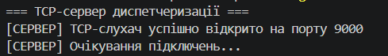
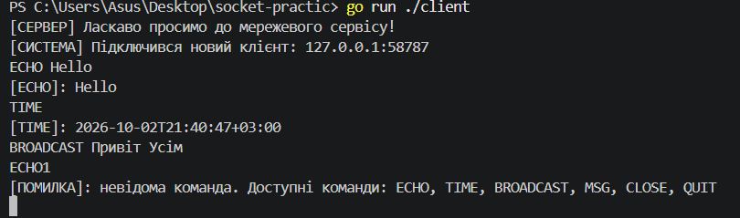
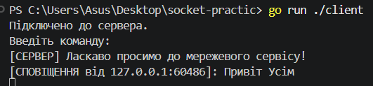
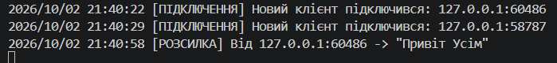
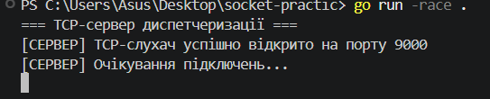

# Практична робота №2

## Тема

**Сокетне програмування та обмін повідомленнями по TCP/UDP**

## Мета роботи

Опанувати принципи низькорівневого мережевого програмування в Go, навчитися створювати TCP-сервер, працювати з декількома клієнтами, використовувати горутини та синхронізацію доступу до спільних даних.

## Виконані завдання

У межах практичної роботи реалізовано:

- TCP-сервер на порту `9000`;
- обробку декількох клієнтів;
- окрему горутину для кожного клієнта;
- текстовий протокол обміну повідомленнями;
- команду `ECHO`;
- команду `TIME`;
- команди `CLOSE` та `QUIT`;
- обробку невідомих команд;
- облік активних клієнтів через `map[net.Conn]bool`;
- захист спільної колекції клієнтів за допомогою `sync.Mutex`;
- системні повідомлення про підключення та відключення клієнтів;
- широкомовну розсилку за допомогою `BROADCAST` та `MSG`;
- перевірку роботи з декількома клієнтами;
- перевірку програми за допомогою Go Race Detector.

> **Примітка:** третій рівень практичної роботи (UDP-телеметрія та graceful shutdown) не реалізовувався.

---

## Структура проєкту

```text
socket-practic/
├── go.mod
├── main.go
├── client/
│   └── main.go
├── screenshots/
│   ├── 01-server.png
│   ├── 02-client-commands.png
│   ├── 03-three-clients.png
│   ├── 04-broadcast.png
│   ├── 05-server-logs.png
│   └── 06-race-detector.png
└── README.md
```

---

# Хід виконання роботи

## 1. Запуск TCP-сервера

Для запуску сервера використовується команда:

```powershell
go run .
```

Сервер відкриває TCP-порт `9000` та очікує підключення клієнтів.

### Результат запуску

На сервері відображається:

### Скріншот



---

## 2. Підключення клієнта

Для запуску клієнта використовується команда:

```powershell
go run ./client
```

Після підключення сервер надсилає привітальне повідомлення:

```text
Підключено до сервера.
Введіть команду:
[СЕРВЕР] Ласкаво просимо до мережевого сервісу!
```

---

## 3. Перевірка команд ECHO, TIME та обробки помилок

Клієнт підтримує команду:

```text
ECHO <повідомлення>
```

Наприклад:

```text
ECHO Hello
```

Результат:

```text
[ECHO]: Hello
```

Команда:

```text
TIME
```

повертає поточний час сервера у форматі RFC3339.

Приклад:

```text
[TIME]: 2026-10-02T21:23:41+03:00
```

При введенні невідомої команди сервер повертає повідомлення про помилку:

```text
[ПОМИЛКА]: невідома команда. Доступні команди: ECHO, TIME, BROADCAST, MSG, CLOSE, QUIT
```

### Скріншот

На одному скріншоті показано перевірку `ECHO`, `TIME` та невідомої команди.



---

## 5. Широкомовна розсилка

Для надсилання повідомлення всім іншим активним клієнтам використовується команда:

```text
BROADCAST <повідомлення>
```

Наприклад:

```text
BROADCAST Привіт усім
```

Інші клієнти отримують повідомлення:

```text
[СПОВІЩЕННЯ від 127.0.0.1:54205]: Привіт усім
```

Відправник власне повідомлення назад не отримує.

### Скріншот



На скріншоті показано відправлення повідомлення одним клієнтом та його отримання іншим клієнтом.

---

## 6. Системні повідомлення

Сервер повідомляє активних клієнтів про підключення нового клієнта та відключення існуючого клієнта.

Приклад повідомлення:

```text
[СИСТЕМА] Підключився новий клієнт: 127.0.0.1:54205
```

При відключенні:

```text
[СИСТЕМА] Клієнт вийшов: 127.0.0.1:54205
```

Сервер також виводить інформацію про підключення та широкомовні повідомлення у консоль:

```text
[ПІДКЛЮЧЕННЯ] Новий клієнт підключився: 127.0.0.1:54205
[РОЗСИЛКА] Від 127.0.0.1:54205 -> "Привіт усім"
[ВІДКЛЮЧЕННЯ] Клієнт відключився: 127.0.0.1:54205
```

### Скріншот



---

## 7. Завершення з'єднання

Для завершення з'єднання використовується команда:

```text
CLOSE
```

Сервер надсилає клієнту:

```text
[СЕРВЕР] До побачення!
```

Після цього TCP-з'єднання закривається.

---

## 8. Перевірка Race Detector

Для перевірки конкурентного доступу до спільних даних використовується:

```powershell
go run -race .
```

Сервер успішно запускається та може обробляти декілька клієнтів.

Під час тестування повідомлення:

```text
WARNING: DATA RACE
```

не виникає.

### Скріншот



На скріншоті показано запуск сервера через `go run -race .` без повідомлень про `DATA RACE`.

---

# Результати роботи

У результаті виконання практичної роботи було перевірено:

- запуск TCP-сервера;
- підключення незалежних клієнтів;
- виконання команди `ECHO`;
- отримання серверного часу через `TIME`;
- обробку невідомих команд;
- одночасну роботу трьох клієнтів;
- системні повідомлення про підключення та відключення;
- широкомовну розсилку через `BROADCAST`;
- завершення TCP-з'єднання через `CLOSE`;
- відсутність `DATA RACE` під час перевірки Race Detector.

---

# Використані технології

- Go
- TCP
- Goroutines
- `sync.Mutex`
- `net`
- `bufio`
- Race Detector
- PowerShell

---

# Запуск проєкту

## Запуск сервера

```powershell
go run .
```

## Запуск клієнта

В окремому терміналі:

```powershell
go run ./client
```

Для тестування декількох клієнтів потрібно відкрити декілька терміналів та виконати команду запуску клієнта в кожному.

## Запуск із Race Detector

```powershell
go run -race .
```

---

# Команди клієнта

| Команда | Призначення |
|---|---|
| `ECHO <message>` | Повертає передане повідомлення |
| `TIME` | Показує поточний час сервера |
| `BROADCAST <message>` | Надсилає повідомлення іншим клієнтам |
| `MSG <message>` | Альтернативна команда широкомовної розсилки |
| `CLOSE` | Закриває з'єднання |
| `QUIT` | Закриває з'єднання |

---